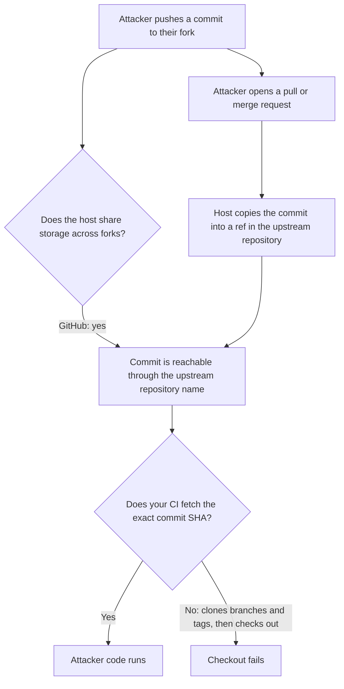

# Mutable References Beyond GitHub Actions

[What Pinning Misses](pinning-surface.md) explains mutable references using GitHub Actions.
This page answers the obvious next question: is this a GitHub problem, or does every CI platform have it?

Every platform has it.
What differs is how much the platform does about it for you.
`pin-actions` only rewrites GitHub Actions workflows, but the ideas on this page apply to whatever CI system you use.

Every claim below was checked against the vendor's own documentation on 2026-10-20.
Where a claim is our reading of source code or behavior rather than something a vendor states,
it is labelled **inference**.

## 1. Two layers, two different problems

A CI configuration file pulls in other people's code in two separate ways.
It helps to keep them apart, because they have different owners and different fixes.

| Layer            | What it is                                                                                                        | Who decides whether it can change                       |
| ---------------- | ----------------------------------------------------------------------------------------------------------------- | ------------------------------------------------------- |
| **Config layer** | Reusable pipeline code: GitHub actions, GitLab includes, CircleCI orbs, Azure tasks, Jenkins libraries, and so on | The CI platform's design                                |
| **Image layer**  | Container images your jobs, steps, plugins, and services run inside                                               | The container registry, and whoever publishes the image |

The config layer is different on every platform.
The image layer is the same on every platform, because every platform pulls images from OCI-compatible registries.

## 2. The config layer, platform by platform

| Platform            | How you reference shared code                   | Mutable by default?                         | What the platform does about it                                         |
| ------------------- | ----------------------------------------------- | ------------------------------------------- | ----------------------------------------------------------------------- |
| GitHub Actions      | `uses: owner/repo@v4`                           | Yes                                         | Workflow dependency lockfile (public preview) pins and verifies for you |
| GitLab CI           | `include:remote`, `include:project`, components | Yes                                         | Guidance only                                                           |
| CircleCI            | Registry orbs `ns/orb@1.2.3`                    | **No**, if you give the full version        | Published versions cannot be edited or deleted                          |
| Azure Pipelines     | `task: Name@2`                                  | Yes, within the major version               | Full-version pinning available; org-level task restrictions             |
| Jenkins             | `@Library('lib@master')`                        | Yes                                         | Admins can block pipelines from overriding the default version          |
| Buildkite           | `plugins: - docker#v5.13.0`                     | Yes                                         | Guidance only                                                           |
| Tekton              | Resolvers: `git`, `bundles`, `hub`, `http`      | Yes                                         | Optional signature verification (alpha); optional content digest        |
| Drone               | Plugins are container images                    | Yes (see the image layer)                   | Optional config-file signing                                            |
| Bitbucket Pipelines | `import:` shared config; pipes                  | Yes; `import:` accepts only a branch or tag | Guidance only; commit-SHA imports not supported                         |

The rest of this section shows what "mutable" looks like on each platform and what the pinned form is.

=== "GitLab CI"

    GitLab has three ways to pull in shared configuration, and all three are mutable by default.

    ```yaml
    include:
      # A URL fetched over HTTP when the pipeline starts. There is no version concept at all.
      - remote: https://gitlab.com/example/ci/-/raw/main/template.yml
      # A file from another project, at a branch.
      - project: example/ci
        ref: main
        file: template.yml
      # A CI/CD component at a partial version: receives every 1.x.y release automatically.
      - component: gitlab.com/example/components/lint@1
    ```

    Components resolve `@<version>` in this order: commit SHA, then tag, then branch,
    then `~latest` or a partial version.
    GitLab's component documentation actively suggests partial versions so you "automatically receive minor
    or patch updates", while its security guidance says to "Pin CI/CD components to a specific commit SHA (preferred)
    or release version tag".
    Both are true; they serve different goals.

    Includes can nest up to 150 levels deep, and none of them are locked.
    A pinned top-level include can still pull in a mutable nested one.

    **Pinned form:** a full commit SHA in `ref:` and after `@`.
    Avoid `include:remote` for anything you do not control.

=== "CircleCI"

    CircleCI is the platform that got the config layer right.
    A production registry orb version is immutable:

    > Are immutable: they cannot be deleted or edited, and updates must be provided in a new SemVer release.
    > — [CircleCI: Orbs concepts](https://circleci.com/docs/orb-concepts/)

    Orbs that depend on other orbs have those dependencies resolved when the orb is *published*,
    not when your build runs.
    That is effectively a built-in lockfile.

    You can still opt back into mutability:

    ```yaml
    orbs:
      node: circleci/node@5.2.0     # immutable
      aws: circleci/aws-cli@4       # receives every 4.x.y release
      slack: circleci/slack@volatile  # latest published version, whatever it is
    ```

    URL orbs (fetched from a URL) and development orbs (`@dev:...`) are documented as mutable.

    **Pinned form:** the full `x.y.z` version of a registry orb.

=== "Azure Pipelines"

    Azure tasks are referenced by major version, and minor versions update underneath you:

    > Pipelines automatically update to use new minor task versions, such as 1.2 to 1.3.
    > — [Azure Pipelines: Task types and usage](https://learn.microsoft.com/en-us/azure/devops/pipelines/process/tasks)

    ```yaml
    steps:
      - task: PublishTestResults@2   # any 2.x
      - task: GoTool@0.3.1           # exactly 0.3.1
    ```

    Marketplace tasks are installed as packaged extensions, not fetched from a Git repository at run time.

    **Pinned form:** the full task version after `@`.

=== "Jenkins"

    Shared libraries are Git repositories, and the version can be any Git ref — commonly a branch:

    ```groovy
    @Library('my-shared-library@master') _
    library "my-shared-library@$BRANCH_NAME"   // the version can even be computed
    ```

    This matters more on Jenkins than elsewhere.
    A library configured as *trusted* runs outside the Groovy sandbox, and Jenkins' own documentation warns:

    > anyone able to push commits to this SCM repository could obtain unlimited access to Jenkins.
    > — [Jenkins: Extending with Shared Libraries](https://www.jenkins.io/doc/book/pipeline/shared-libraries/)

    **Pinned form:** a full commit SHA, configured as the library's default version, with overrides disabled.

=== "Buildkite"

    Plugins are Git repositories referenced by tag:

    ```yaml
    steps:
      - plugins:
          - docker#v5.13.0:              # a Git tag
              image: node
          - docker-compose#287293c4:     # a commit
              run: app
    ```

    Buildkite's documentation is direct about why the second form exists:
    "To avoid a plugin's git tag contents being changed, you can use the commit SHA of the tag."

    **Pinned form:** a commit SHA after `#`.

=== "Tekton"

    Tekton pulls remote Tasks and Pipelines through *resolvers*, and each one has its own mutability story:

    - **`git`**: `revision` accepts a branch, tag, or commit SHA. If omitted, the shipped default is `main`.
    - **`bundles`**: an OCI image reference, by tag or by `@sha256:` digest.
    - **`hub`**: `version` accepts an exact version or a constraint such as `>=0.7.0`,
      which resolves to the latest match.
    - **`http`**: any URL, with an optional `digest: sha256:...` integrity check.

    Tekton offers *Trusted Resources*, which verifies signatures on remotely fetched Tasks and Pipelines.
    It is an alpha feature, and resources that match no verification policy are ignored by default.

    **Pinned form:** a commit SHA for `git`, a digest for `bundles`, an exact version for `hub`,
    and always set `digest` for `http`.

=== "Drone"

    Drone plugins *are* container images:

    ```yaml
    steps:
      - name: notify
        image: plugins/slack   # no tag means :latest, re-pulled on every run
    ```

    So on Drone, the config-layer problem collapses into the image-layer problem in the next section.
    Drone can sign the `.drone.yml` file itself, but that proves the file was not tampered with;
    it does not pin anything the file refers to.

    The Drone codebase now serves as the base of Harness Open Source, with Drone continuing on a separate branch.

    **Pinned form:** an image digest.

=== "Bitbucket Pipelines"

    Bitbucket Cloud shares pipeline definitions with `import:`, and the source is always a branch or a tag:

    ```yaml
    definitions:
      imports:
        shared: shared-pipelines:main          # repository:branch-or-tag
    pipelines:
      default:
        import: build@shared
    ```

    Atlassian's documentation says a branch import "will always reference the HEAD commit of the targeted branch",
    and that commit-SHA imports are not available yet: "In the future,
    we may add support for pinning to specific commits".
    Imports only work between repositories in the same workspace.

    *Pipes*, Bitbucket's reusable steps, are container images
    (`pipe: atlassian/aws-s3-deploy:0.2.2`), so they belong to the image layer.

    **Pinned form:** a tag you control for `import:`, because nothing more immutable exists; for pipes,
    check the image layer guidance below.

## 3. The image layer is the same everywhere

Every platform above runs containers, and every container image is identified one of two ways:

```text
python:3.14-slim                                  # a tag: a name that points at an image
python@sha256:4f3c...e1a9                         # a digest: a fingerprint of the image's exact bytes
```

This is the same distinction as a Git tag versus a commit SHA.
A tag is a pointer that the image's publisher can move.
A digest is computed from the content, so it cannot point at anything else.
The [OCI Distribution Specification](https://github.com/opencontainers/distribution-spec)
that every major registry implements works this way; it is not a quirk of any one registry.

### "But my registry supports immutable tags"

Some registries let a publisher lock tags:

| Registry                  | Tag immutability                                                                    | Default |
| ------------------------- | ----------------------------------------------------------------------------------- | ------- |
| Docker Hub                | Beta; opt-in per repository, for all tags or tags matching a pattern                | Mutable |
| Amazon ECR                | Per repository: `IMMUTABLE`, or `IMMUTABLE_WITH_EXCLUSION` with wildcard exceptions | Mutable |
| GitHub Container Registry | No tag-immutability setting documented; GitHub's docs recommend pulling by digest   | Mutable |

The catch is in the second column of the table in §1: **the publisher** turns this on, not you.
When you write `image: redis:7`, you cannot tell from your side whether `redis` has immutability enabled,
you will not be notified if it is turned off, and there is no way to require it in your pipeline.

Publisher-side immutability is a good practice for people who *publish* images.
For people who *consume* them, the only control you own is the digest.

### Where images hide in CI configuration

Images appear in more places than `image:` at the top of a job:

- GitHub Actions: `container:`, `services:`, `uses: docker://...`, and `runs.image` inside Docker container actions.
- GitLab CI: `image:` and `services:` at the job or default level.
- CircleCI: `docker:` executors, including executors defined *inside* an orb.
- Drone: every plugin.
- Tekton: `steps[].image` in every Task, including Tasks you fetch through a resolver.

!!! warning "An immutable wrapper does not pin what is inside it"

    CircleCI's own documentation shows an orb executor defined
    as `cimg/ruby:<< parameters.tag >>` with a default tag of `'2.7'`.
    Pinning that orb to an exact, immutable version still runs a mutable image.
    The same is true of a SHA-pinned GitHub action that runs a container by tag,
    and a digest-pinned Tekton bundle whose Tasks name images by tag.
    Each layer has to be pinned separately.

## 4. Impostor commits beyond GitHub

[What Pinning Misses §4](pinning-surface.md#4-a-sha-tells-you-what-code-runs-not-whose) explains *impostor commits*:
on GitHub, a commit pushed only to an attacker's fork can be fetched through the *original* repository's name.
A pin like `trusted/action@<sha>` can look correct and still run the attacker's code.

There are two separate ways a commit the maintainers never accepted can end up reachable through their repository.

**Path A — a shared object store.**
GitHub stores a repository and all its forks together.
GitHub's documentation says so directly:
"Git data from any repository in a network may be accessed from any repository in the same network,
including the upstream repository, even after a fork is deleted."
[Chainguard's 2023 research](https://www.chainguard.dev/unchained/what-the-fork-imposter-commits-in-github-actions-and-ci-cd)
demonstrated this with both `git fetch` and the GitHub API.

**Path B — pull request and merge request refs.**
When someone opens a pull request (GitHub) or merge request (GitLab) from a fork,
the platform copies their commit into a special ref inside the *target* repository,
such as `refs/pull/123/head` or `refs/merge-requests/45/head`.
This is how reviewers can check out a contributor's change.
It also means the contributor's commit is now reachable through the target repository,
without any maintainer approving anything.



### Whether *you* are exposed depends on how your tool fetches

The host making a commit reachable is only half the attack.
The other half is whether the tool reading your pin asks for that exact commit.

- Tools that **fetch the SHA directly** will receive a commit the host is willing to serve.
- Tools that **clone branches and tags, then check out the SHA** will not find a commit that only lives in a fork.

| Platform or tool                                  | Fetches the exact SHA?                    | Exposure                                                                                           | Confidence                          |
| ------------------------------------------------- | ----------------------------------------- | -------------------------------------------------------------------------------------------------- | ----------------------------------- |
| GitHub Actions `uses:`                            | Yes                                       | **Exposed** (path A)                                                                               | Verified (Chainguard)               |
| GitHub Actions with a lockfile                    | Verified against the source repo          | **Not exposed**; commit must be on a branch                                                        | Vendor-documented                   |
| GitLab: shared fork storage                       | —                                         | **Not exposed** to path A                                                                          | Inference from GitLab's docs        |
| GitLab: merge request refs                        | Yes, for `include:project` and components | **Exposed** to path B; keep-around refs can keep the commit resolvable after the MR ref is deleted | Inference from GitLab source        |
| CircleCI registry orbs                            | Not Git                                   | **Not exposed**                                                                                    | Vendor-documented                   |
| Azure Marketplace tasks                           | Not Git                                   | **Not exposed**                                                                                    | Vendor-documented                   |
| Azure `checkout:` of a GitHub repository resource | Yes                                       | **Exposed** on GitHub (paths A and B)                                                              | Inference from agent source         |
| Bitbucket Cloud                                   | —                                         | **Not exposed** to path B: no pull request refs; path A undocumented                               | Vendor issue tracker                |
| Bitbucket Data Center                             | —                                         | **Exposed** to path B for clients that fetch a SHA                                                 | Inference from vendor issue tracker |
| Jenkins shared libraries (default)                | No; requires a containing branch          | **Not exposed**                                                                                    | Inference from plugin source        |
| Buildkite plugins                                 | No; clones, then checks out               | **Not exposed**                                                                                    | Inference from agent source         |
| Tekton `git` resolver                             | Yes                                       | **Exposed** on GitHub (path A)                                                                     | Inference from Tekton's docs        |
| pre-commit `rev:`                                 | Yes                                       | **Exposed** on GitHub (path A)                                                                     | Inference from pre-commit source    |
| pip `git+https://...@<sha>`                       | Yes                                       | **Exposed** on GitHub (path A)                                                                     | Inference from pip source           |
| Go modules                                        | No, by design                             | **Not exposed**                                                                                    | Stated in Go source                 |

The Go module system is a useful example of a deliberate choice.
Its source code says:

> We do NOT fetch arbitrary hashes (when we don't know the ref) because we want to avoid ever importing a commit
> that isn't reachable from refs/tags/* or refs/heads/* or HEAD.
> — [`cmd/go/internal/modfetch/codehost/git.go`](https://github.com/golang/go/blob/master/src/cmd/go/internal/modfetch/codehost/git.go)

That one rule is what GitHub's lockfile now enforces for actions: the commit must be on a real branch.

!!! note "GitLab: a merge request is enough, and it may never expire"

    When GitLab loads `include:project` with `ref: <sha>`, or a component at `@<sha>`,
    it looks the commit up by ID in the target project.
    Its source code does not check that the commit is on a branch or tag.
    Opening a merge request copies the contributor's commit into the target project under
    `refs/merge-requests/<iid>/head`.
    GitLab deletes that ref 14 days after the merge request closes,
    but it also writes a separate `refs/keep-around/<sha>` ref for each merge request version.
    Our reading of the source is that the commit stays resolvable long after the merge request is gone.
    We have not tested this end to end.

!!! note "Azure Pipelines: the agent asks GitHub for the exact commit"

    When a job checks out a GitHub repository resource,
    the Azure Pipelines agent fetches the resolved commit SHA directly
    (`git fetch origin +<sha>`) on Git 2.26 or later, unless the `VSTS.DisableFetchByCommit` knob is set.
    GitHub serves fork and pull request commits to that request, so a SHA from a fork checks out.
    Whether `ref:` on a `type: github` resource accepts a raw SHA is not clearly documented.

!!! note "pre-commit is the one to watch"

    pre-commit fetches each hook's `rev:` directly,
    and its documentation says it "assumes that the value of `rev` is an immutable ref (such as a tag or SHA)".
    A SHA in `.pre-commit-config.yaml`
    that points at a commit in a fork of the hook's repository is a plausible impostor commit,
    and no lockfile covers pre-commit.
    We have not demonstrated this end to end; treat it as a likely exposure, not a confirmed one.

### What a "verified" commit should mean

Checking that a SHA *resolves* proves nothing; impostor commits resolve by design.
A meaningful check asks whether the commit is reachable from a **branch or tag the maintainers control**.
Pull and merge request refs do not qualify, because anyone can create one.
GitHub's lockfile uses exactly this rule: the commit "must exist within a branch of the source repository."
A merged pull request does qualify, but only for the commit the reviewer saw last:
an earlier commit in the same pull request can be reverted before a squash merge and never land.

## 5. What to do, on any platform

1. **Pin every container image to a digest.**
   This is the one step that applies to every platform, and no platform lockfile does it for you.
2. **Pin config references to the most immutable form your platform offers.**
   A commit SHA for Git-based references; a full `x.y.z` for CircleCI orbs and Azure tasks;
   a digest for Tekton bundles and `http` resolutions.
3. **Avoid the explicitly floating forms.**
   GitLab `include:remote` pointing at a branch, components at `~latest` or a partial version, CircleCI `@volatile`,
   and Jenkins libraries that load a branch by default.
4. **When you pin a SHA, confirm it is on a branch or tag of the repository it claims to come from.**
   Not merely that it resolves, and not that it appears in an open pull or merge request.
5. **Turn on what your platform offers.**
   GitHub workflow lockfiles, Tekton Trusted Resources, Azure task restrictions, CircleCI URL-orb allow lists,
   and Jenkins' setting that blocks version overrides.
6. **Remember that wrappers do not pin their contents.**
   Check the images inside your orbs, actions, and Tasks, not only the references to them.

`pin-actions` automates steps 1 and 2 for GitHub Actions workflows, and step 2 for pre-commit configurations.
Its `--provenance` option implements step 4 for GitHub: it accepts a branch head, a tag,
or the head or merge commit of a merged pull request, and rejects open pull requests.
[Verify SHA Provenance](../how-to/verify-provenance.md) documents exactly which refs it accepts.
For pinning across several CI systems, [`ratchet`](https://github.com/sethvargo/ratchet) supports GitHub Actions,
GitLab CI, CircleCI, Cloud Build, Drone, and Tekton; see [Comparison with Similar Tools](comparison.md).

??? info "Sources and what is still unverified"

    **Vendor documentation**

    - GitHub: [Forks](https://docs.github.com/en/pull-requests/collaborating-with-pull-requests/working-with-forks/about-forks),
      [Workflow dependency lockfiles](https://docs.github.com/en/actions/concepts/security/workflow-dependency-lockfiles),
      [Working with the Container registry](https://docs.github.com/en/packages/working-with-a-github-packages-registry/working-with-the-container-registry)
    - GitLab: [`include`](https://docs.gitlab.com/ci/yaml/includes/),
      [CI/CD components](https://docs.gitlab.com/ci/components/),
      [Git object deduplication](https://docs.gitlab.com/development/git_object_deduplication/),
      [Merge request troubleshooting](https://docs.gitlab.com/user/project/merge_requests/merge_request_troubleshooting/)
    - CircleCI: [Orbs concepts](https://circleci.com/docs/orb-concepts/), [Orbs FAQ](https://circleci.com/docs/orbs-faq/)
    - Azure Pipelines: [Task types and usage](https://learn.microsoft.com/en-us/azure/devops/pipelines/process/tasks)
    - Jenkins: [Extending with Shared Libraries](https://www.jenkins.io/doc/book/pipeline/shared-libraries/)
    - Buildkite: [Using plugins](https://buildkite.com/docs/pipelines/integrations/plugins/using)
    - Tekton: [Git resolver](https://tekton.dev/docs/pipelines/git-resolver/),
      [Bundles resolver](https://tekton.dev/docs/pipelines/bundle-resolver/),
      [Hub resolver](https://tekton.dev/docs/pipelines/hub-resolver/),
      [HTTP resolver](https://tekton.dev/docs/pipelines/http-resolver/),
      [Trusted Resources](https://tekton.dev/docs/pipelines/trusted-resources/)
    - Drone: [Plugins](https://docs.drone.io/plugins/overview/), [Signature](https://docs.drone.io/signature/)
    - Docker Hub: [Immutable tags](https://docs.docker.com/docker-hub/repos/manage/hub-images/immutable-tags/)
    - Amazon ECR: [Image tag mutability](https://docs.aws.amazon.com/AmazonECR/latest/userguide/image-tag-mutability.html)
    - Bitbucket Cloud: [Fork a repository](https://support.atlassian.com/bitbucket-cloud/docs/fork-a-repository/),
      [Share Pipelines configurations](https://support.atlassian.com/bitbucket-cloud/docs/share-pipelines-configurations/),
      [What are pipes?](https://support.atlassian.com/bitbucket-cloud/docs/what-are-pipes/)

    **Source code and issue trackers**

    - GitLab: [`file/project.rb`](https://gitlab.com/gitlab-org/gitlab/-/blob/master/lib/gitlab/ci/config/external/file/project.rb)
      and
      [`components/instance_path.rb`](https://gitlab.com/gitlab-org/gitlab/-/blob/master/lib/gitlab/ci/components/instance_path.rb)
      resolve a ref with `project.commit`;
      [`merge_request_diff.rb`](https://gitlab.com/gitlab-org/gitlab/-/blob/master/app/models/merge_request_diff.rb)
      enqueues keep-around refs for each merge request version
    - Azure Pipelines agent: [`GitSourceProvider.cs`](https://github.com/microsoft/azure-pipelines-agent/blob/master/src/Agent.Plugins/GitSourceProvider.cs)
      and
      [`AgentKnobs.cs`](https://github.com/microsoft/azure-pipelines-agent/blob/master/src/Agent.Sdk/Knob/AgentKnobs.cs)
      (`DisableFetchByCommit` defaults to `false`)
    - Atlassian: [BCLOUD-5814](https://jira.atlassian.com/browse/BCLOUD-5814) requests pull request refs
      for Bitbucket Cloud, open since 2012;
      [BSERV-12284](https://jira.atlassian.com/browse/BSERV-12284) documents `refs/pull-requests/<id>/from` on Bitbucket
      Data Center

    **Research**

    - Chainguard, [What the fork? Imposter commits in GitHub Actions and CI/CD](https://www.chainguard.dev/unchained/what-the-fork-imposter-commits-in-github-actions-and-ci-cd) (2023)

    **Not yet verified**

    - Bitbucket Cloud: whether forks share storage with the parent repository is undocumented.
      Bitbucket restricts new forks to the parent workspace from July 1, 2026, which limits who could attempt it.
    - Azure Pipelines: whether compile-time template resolution from a `type: github` resource
      accepts a commit that exists only in a fork; the server code is not public.
    - GitLab and Azure findings above come from reading source code, not from end-to-end tests.
    - Cloud Build and Woodpecker have not been reviewed.

## See also

- [What Pinning Misses](pinning-surface.md) — the GitHub Actions version of this page, with measurements
- [Threat Model](threat-model.md) — the full analysis for GitHub Actions
- [Pin Container Images](../how-to/pin-container-images.md) — digest-pinning the image layer with `pin-actions`
- [Verify SHA Provenance](../how-to/verify-provenance.md) — checking that a SHA comes from the repository it names
