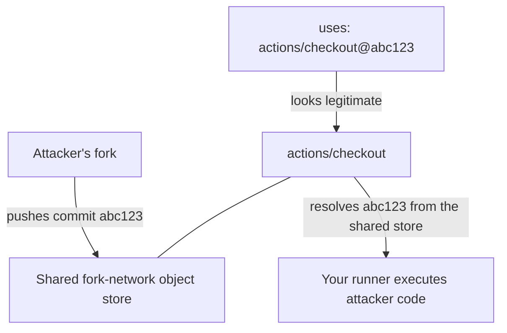

# What Pinning Misses

Almost every CI security guide gives you the same advice: pin your GitHub Actions to a commit SHA.
The advice is correct.
It is also incomplete, and nobody tells you by how much.

This page explains what pinning does and does not protect,
and backs it with measurements from a scan of ~2,000 public repositories.
It assumes you have written a GitHub Actions workflow before.
It does not assume you know anything about supply-chain security.

## 1. The one idea you need first

A workflow runs code that lives somewhere else.
When you write this:

```yaml
- uses: actions/checkout@v4
```

you are saying "run whatever code is at the tag `v4` in the repository `actions/checkout`."

The problem is that `v4` is a **mutable reference**.
It is a label pointing at a commit, and labels can be moved.
Whoever controls that repository can point `v4` at different code tomorrow,
and your workflow will run the new code without you changing a single line.

A commit SHA is an **immutable reference**:

```yaml
- uses: actions/checkout@11bd71901bbe5b1630ceea73d27597364c9af683 # v4.2.2
```

That 40-character string is a cryptographic fingerprint of the exact code.
It cannot be repointed.
This is why "pin your actions" became standard advice, and it is genuinely effective —
it is why SHA-pinned repositories were unaffected by the tag-hijacking incidents of recent years.

!!! note "Keep the trailing comment"

    The `# v4.2.2` comment is not decoration.
    It tells human reviewers what the SHA means,
    and it is how Dependabot and Renovate know which version to bump you to.
    `pinref` writes and preserves it automatically.

## 2. `uses:` is not the only way a workflow runs someone else's code

Here is the part the advice usually leaves out.
A workflow file has **at least six** places that can reference code from elsewhere, and `uses:` is only one of them.

```yaml
jobs:
  test:
    container:
      image: python:3.14-slim        # (2) mutable
    services:
      redis:
        image: redis:7               # (3) mutable
    steps:
      - uses: actions/checkout@11bd71901bbe5b1630ceea73d27597364c9af683  # (1) pinned
        with:
          repository: my-org/fixtures
          ref: main                  # (4) mutable
      - uses: docker://alpine:3      # (5) mutable
      - run: pre-commit run          # (6) reads .pre-commit-config.yaml revisions
```

Five of those six references are mutable, and the file would pass every "are your actions pinned?" check ever written.

| Reference               | Example                                       | What someone who controls it gets                                  |
| ----------------------- | --------------------------------------------- | ------------------------------------------------------------------ |
| Action ref              | `uses: actions/checkout@v4`                   | Runs arbitrary code in your job, with your job's token             |
| Reusable workflow ref   | `uses: org/repo/.github/workflows/x.yml@main` | Runs arbitrary jobs, plus any secrets you inherit to them          |
| Cross-repo checkout ref | `with: {repository: org/x, ref: main}`        | Puts arbitrary source on disk, which you usually then build or run |
| Step container image    | `uses: docker://alpine:3`                     | Runs arbitrary code in your job                                    |
| Job container image     | `jobs.<id>.container.image`                   | Controls the environment *every* step in that job runs inside      |
| Service container image | `jobs.<id>.services.<name>.image`             | A network service your job talks to and trusts                     |

A pre-commit configuration adds a seventh: `.pre-commit-config.yaml` has its own `rev:` field per hook,
and if CI runs `pre-commit`, those revisions execute on your runner too.

The important thing to understand is that these are not lesser risks.
A compromised `services.redis.image` is not "a bad database."
It is a program the attacker wrote, running on your runner's network, answering every query your test suite makes.

## 3. What we measured

Knowing the gap exists is not the same as knowing how common it is.
So we scanned for it.

### How the scan worked

1. Build a list of active public repositories: at least 100 stars, not a fork, not archived, pushed recently.
2. Randomly sample 1,996 of them and shallow-clone each one.
3. Parse every workflow file, action definition, and `.pre-commit-config.yaml`.
4. Find the repositories where **every** action reference is already pinned to a SHA —
   the ones that did everything the guides told them to.
5. Within only those repositories, count the references that are still mutable.

Step 4 matters.
We are not measuring "do people pin?"
We are measuring "what is left over *after* people pin?"

### Reading the numbers

| What                                              | Result               | Realistic range       |
| ------------------------------------------------- | -------------------- | --------------------- |
| Repositories that are fully pinned                | 12.7% (168 of 1,321) | 11.0% to 14.6%        |
| Fully pinned repos with *something* still mutable | 13.1% (22 of 168)    | 8.8% to 19.0%         |
| ... a mutable container image                     | 7.1% (12 of 168)     | 4.1% to 12.1%         |
| ... an unpinned cross-repo `with.ref`             | 3.0% (5 of 168)      | 1.3% to 6.8%          |
| ... an unpinned pre-commit revision               | 5 of 8 repositories  | too few to generalize |

??? question "What is the 'realistic range' column?"

    We measured a sample, not every repository on GitHub,
    so the true figure is near our measurement but not exactly on it.
    The range is a 95% confidence interval: informally, the band the real number is very likely to sit in.

    The band gets narrower as the sample gets bigger.
    That is why the last row has no band worth printing — only 8 of the fully pinned repositories ran pre-commit at all,
    and you cannot conclude much from 8 of anything.
    We are reporting it so you know the measurement exists, not so you can quote the percentage.

### What this actually tells you

**Most repositories are not pinned at all.**
Only about one in eight active, popular public repositories has every action reference pinned.
After years of near-universal advice, compliance is the exception.
If your repositories are pinned, you are already ahead of most.

**Among those that are pinned, roughly one in eight has something left over.**
Said honestly, the other seven are clean.
The finding is not that pinning is broken.
The finding is that a real residual surface exists, no guide tells you to look for it,
and when it is there it is arbitrary code execution, not a minor hygiene issue.

**Container images are the biggest leftover.**
If you fix only one thing after reading this page, grep your workflows for `image:`.

!!! warning "Limits of this measurement"

    - Only repositories with 100+ stars. Pinning habits may differ in smaller projects.
    - Only the default branch, as it looked on one day. No history.
    - Docker container *action definitions* (`runs.image` inside an `action.yml`) are not counted,
      so the container-image figure is slightly low.
    - `runs-on: ubuntu-latest` is mutable too, and no tool can pin it. It is not in these numbers.

The scanner, the raw per-repository CSV,
and the sampling seed are published in the repository under
[`notes/corpus_scanner/`](https://github.com/drts01/pinref/tree/trunk/notes/corpus_scanner) so you can re-run it and
check us.

## 4. A SHA tells you *what* code runs, not *whose*

There is a second gap, and it is subtler.

When you fork a repository on GitHub, the fork and the original share one pool of Git objects.
GitHub's own documentation is explicit about the consequence:

> Commits pushed to any repository in a network can be accessible from other repositories in that network,
> including the upstream repository.
> — [GitHub Docs: Forks](https://docs.github.com/en/pull-requests/collaborating-with-pull-requests/working-with-forks/about-forks)

Follow that through to a workflow file.
An attacker forks `actions/checkout`, commits whatever they like to *their fork*, and gets a valid commit SHA back.
That SHA is now reachable through the **upstream** repository's path:



In code review, `actions/checkout@abc123def...` looks exactly like a correct pin.
The repository name is right.
The SHA is a real SHA.
It is 40 hex characters that nobody is going to verify by hand.

This is called an **impostor commit**,
and it is why `pinref` ships [provenance verification](../how-to/verify-provenance.md): before writing a SHA,
it checks that the commit is a branch head, a tag, or a merged pull request commit **on the repository you named**.

GitHub's hardening guide does warn about this, in one sentence:

> When selecting a SHA, you should verify it is from the action's repository and not a repository fork.
> — [GitHub Docs: Secure use reference](https://docs.github.com/en/actions/reference/security/secure-use)

It does not tell you how to verify it, and until recently nothing checked it for you.
See [Threat Model §3.1](threat-model.md#31-github-fork-network-vulnerabilities-imposter-commits) for the full analysis.

## 5. What GitHub now ships: workflow dependency lockfiles

GitHub has released **workflow dependency lockfiles**
(public preview at the time of writing), and you should know about them because they change the advice.

A lockfile lives at `.github/workflows/actions.lock`, is generated by the `gh actions-lock` CLI extension,
and records for every action dependency:

- the `ref` your workflow asks for,
- the `commit` it resolved to,
- the `owner_id` and `repo_id` — the *numeric* identity of the source repository.

At run time GitHub verifies that identity,
and requires that the locked commit "exist within a branch of the source repository."
That is the impostor-commit defence, enforced by the platform.
GitHub states that for repositories that adopt a lockfile, SHA pinning inside workflow files is no longer necessary.

**If you can adopt lockfiles, do.**
They cover transitive action dependencies, which SHA pinning cannot, and they verify provenance natively.

What a lockfile does **not** cover:

| Reference                             | Covered by lockfile?                                                                    |
| ------------------------------------- | --------------------------------------------------------------------------------------- |
| Action refs, including transitive     | Yes                                                                                     |
| Reusable workflow refs                | Yes, but not *their* dependencies — those need a lockfile in the repo that defines them |
| Job / service / step container images | **No**                                                                                  |
| Cross-repo `with.ref`                 | **No**                                                                                  |
| Pre-commit hook revisions             | **No**                                                                                  |
| `runs-on:` runner images              | **No**                                                                                  |

So the lockfile closes the `uses:` column of the table in §2 and leaves the rest of the rows exactly as they were.
The residual surface measured in §3 is the part lockfiles do not touch.

!!! note "Public preview"

    Lockfiles are in public preview and subject to change.
    Verify current behavior against
    [GitHub's documentation](https://docs.github.com/en/actions/concepts/security/workflow-dependency-lockfiles) before
    depending on it.

## 6. What to do, in order

1. **Adopt a workflow dependency lockfile** if the feature is available to you.
   It is the strongest control for action references and it verifies provenance for you.
2. **Pin every action reference to a full commit SHA** if you cannot.
   Keep the `# v4.2.2` comment.
3. **Verify provenance when you pin.**
   Any new SHA in a pull request should be checked against the repository it claims to come from —
   `pinref --provenance strict` refuses to write one that is not.
4. **Grep for `image:`, not just `uses:`.**
   Pin container images to `sha256:` digests.
5. **Grep for `ref:` under `with:`.**
   A cross-repo checkout is a code dependency.
6. **Check `.pre-commit-config.yaml` revisions** if CI runs pre-commit.
7. **Wait before adopting brand-new releases.**
   Most supply-chain compromises are caught within days.
   `--exclude-newer '7 days'` refuses releases younger than your cooldown window.
8. **Run both a detector and a fixer.**
   They are different jobs: `zizmor` finds problems across many vulnerability classes;
   `pinref` and similar tools remediate them.

One command covers steps 2 through 7:

```bash
pinref --provenance strict --exclude-newer '7 days'
```

## See also

- [Mutable References Beyond GitHub Actions](mutable-references-across-platforms.md) — the same problem on GitLab,
  CircleCI, Azure Pipelines, Jenkins, Buildkite, Tekton, Drone, and container registries
- [Threat Model](threat-model.md) — the full architectural analysis, including `pull_request_target` abuse
- [Comparison with Similar Tools](comparison.md) — which tools cover which of the six reference types
- [Verify SHA Provenance](../how-to/verify-provenance.md) — how to turn on impostor-commit checking
- [Pin Container Images](../how-to/pin-container-images.md) — closing the biggest leftover
- [Pin Pre-Commit Hooks](../how-to/pin-pre-commit-hooks.md) — closing the seventh reference type
